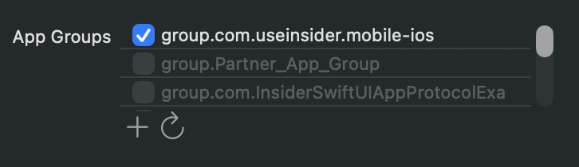
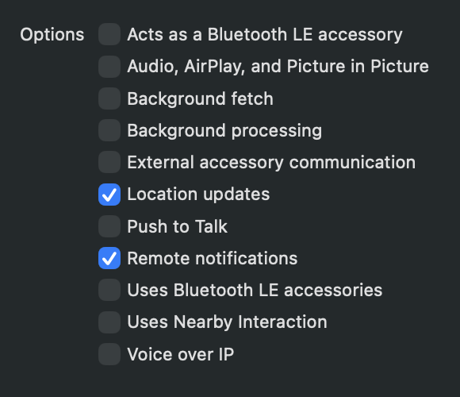

# Insider Flutter SDK Example

[](https://pub.dev/packages/flutter_insider)

<p align="center">
  
</p>

<p align="center">
  <a href="https://insiderone.com/">Insider</a> &bull;
  <a href="https://academy.insiderone.com/docs/flutter-integration">Documentation</a> &bull;
  <a href="https://pub.dev/packages/flutter_insider">pub.dev</a> &bull;
  <a href="LICENSE">MIT License</a>
</p>

This project demonstrates how to integrate the [Insider Flutter SDK](https://academy.insiderone.com/docs/flutter-integration) into a Flutter application on **iOS** and **Android**. One Dart codebase drives both platforms; the `flutter_insider` plugin brings the native Insider SDKs with it. 

- On iOS, the native SDKs can be resolved with **Swift Package Manager** or **CocoaPods**.
- On Android, they come from the Insider Maven repository through Gradle. 

The app includes working examples of every major SDK feature, the two iOS push notification extensions, and Firebase / Huawei push on Android.

## Contents

- [Requirements](#requirements)
- [Project Structure](#project-structure)
- [Getting Started](#getting-started)
- [Swift Package Manager (iOS)](#swift-package-manager-ios)
- [SDK Initialization](#sdk-initialization)
- [App Frames](#app-frames)
- [Push Notifications](#push-notifications)
- [Firebase Messaging alongside Insider](#firebase-messaging-alongside-insider)
- [Runtime Permissions (Android)](#runtime-permissions-android)
- [Public API Usage](#public-api-usage)
- [License](#license)

## Requirements

| Requirement | Minimum |
|---|---|
| Flutter | 3.38 (UIScene app delegate, `FlutterImplicitEngineDelegate`) |
| Dart | The version bundled with Flutter (`flutter_lints` 6 needs 3.8+) |
| iOS | 15.6, Xcode 15 |
| Android | API 24 (Android 7.0), compile SDK 36, target SDK from Flutter (`flutter.targetSdkVersion`) |
| Android Gradle Plugin | 8.13 (Gradle 9.1) |
| JDK | 17 |

## Project Structure

```
lib/
├── main.dart                        # SDK initialization & callback handler
├── firebase_options.dart            # Placeholder, replaced by `flutterfire configure`
├── firebase/
│   └── insider_push_bridge.dart     # Routes Firebase messages to Insider or the app
├── components/                      # Shared widgets
├── theme/                           # Colors and theme
└── insider/                         # One page per SDK feature
    ├── user_attribute.dart, user_identifier.dart
    ├── event.dart, product.dart, purchase.dart, wishlist.dart
    ├── smart_recommender.dart, content_optimizer.dart
    ├── page_visit.dart, gdpr.dart, geofence.dart
    ├── in_app_messages.dart
    ├── app_cards.dart, app_cards_page.dart
    └── app_frames_page.dart         # InsiderAppFramesView per placement

ios/
├── Podfile                          # Adds InsiderMobileAdvancedNotification to Runner in CocoaPods mode
├── Runner/                          # AppDelegate, SceneDelegate, Info.plist (App Frames opt-in), entitlements
├── InsiderNotificationService/      # Rich push (Service Extension)
│   └── NotificationService.swift
└── InsiderNotificationContent/      # Interactive push (Content Extension)
    ├── NotificationViewController.swift
    └── InsiderInterface.storyboard

android/
├── build.gradle                     # Insider & Huawei Maven repositories, plugin classpaths
├── settings.gradle                  # AGP / Kotlin plugin versions
└── app/
    ├── build.gradle                 # applicationId, partner placeholder, signing
    ├── google-services.json         # Firebase (git-ignored, you provide it)
    ├── agconnect-services.json      # Huawei (git-ignored, you provide it)
    └── src/main/
        ├── AndroidManifest.xml      # Permissions, launcher activity, App Frames opt-in
        └── kotlin/.../MainActivity.kt
```

> The two iOS notification extensions are shared by both dependency managers. They link `InsiderMobileAdvancedNotification` from `Runner.app` and carry their own `InsiderInterface.storyboard`, so nothing in them changes when you switch channels.

## Getting Started

### 1. Clone the Repository

```bash
git clone git@github.com:useinsider/FlutterDemo.git
cd FlutterDemo
flutter pub get
```

The demo also integrates Firebase Messaging next to Insider (see [Firebase Messaging alongside Insider](#firebase-messaging-alongside-insider)). Point it at your own Firebase project with the FlutterFire CLI; the command overwrites the placeholder `lib/firebase_options.dart` with your project's values, so do not commit the result:

```bash
dart pub global activate flutterfire_cli
flutterfire configure
```

Without this step the app still runs; Firebase is skipped with a `[FCM] Firebase not configured` log and only the Insider SDK is active.

### 2. Configure Your App

The values you must replace in Dart, Swift and Gradle sources are marked with a `FIXME-INSIDER` comment; search for that key to find them. The iOS URL scheme in `ios/Runner/Info.plist`, the App Group in the three `.entitlements` files and the bundle identifiers in the Xcode project carry no marker; they are covered in the iOS steps below.

#### Dart (both platforms)

**Partner Name** and **App Group** in [`lib/main.dart`](lib/main.dart). The app group is only used on iOS, but the same call initializes both platforms:

```dart
await FlutterInsider.Instance.init(
    "YOUR_PARTNER_NAME", "YOUR_APP_GROUP",
    (int type, dynamic data) { /* ... */ });
```

#### iOS

1. **App Group** identifier in all of these files. It must be identical everywhere, and the App Groups capability must be enabled for all three bundle identifiers in your Apple Developer account:
   - `appGroup` in [`ios/InsiderNotificationService/NotificationService.swift`](ios/InsiderNotificationService/NotificationService.swift)
   - `appGroup` in [`ios/InsiderNotificationContent/NotificationViewController.swift`](ios/InsiderNotificationContent/NotificationViewController.swift)
   - `com.apple.security.application-groups` in [`ios/Runner/Runner.entitlements`](ios/Runner/Runner.entitlements), [`ios/InsiderNotificationService/InsiderNotificationService.entitlements`](ios/InsiderNotificationService/InsiderNotificationService.entitlements) and [`ios/InsiderNotificationContent/InsiderNotificationContent.entitlements`](ios/InsiderNotificationContent/InsiderNotificationContent.entitlements)

2. **Signing & Capabilities** for every target (`Runner` + both extensions):
   - Set your bundle identifiers; the extension identifiers must be prefixed with the app identifier
   - Set your development team
   - Enable **Push Notifications**
   - Add an **App Groups** capability with the same identifier used above

   

   - Enable **Background Modes**: Remote notifications, Location updates

   

> **Important:** The App Group identifier must be identical across the main app target, both notification extension targets and the `init` call in `lib/main.dart`. A mismatch will prevent the SDK from sharing data between the app and its extensions.

3. **URL Scheme**: In the `Runner` target's **Info** tab under **URL Types**, set the scheme to match your partner name (e.g., `insideryourpartnername`). This is what lets you register a test device from the panel with a QR code or e-mail.

#### Android

Update the following values in [`android/app/build.gradle`](android/app/build.gradle):

- **Partner Name** — the SDK reads it from the manifest placeholder; it must match the name passed to `init` in Dart. This is also what lets you register a test device from the panel with a QR code or e-mail:

```groovy
manifestPlaceholders = [ 'partner': 'YOUR_PARTNER_NAME' ]
```

- **Application ID** — must match the package registered in your `google-services.json`:

```groovy
applicationId "com.your.package.name"
```

- **Firebase** — drop your `google-services.json` into `android/app`. The file is git-ignored.

- **Huawei** — drop your `agconnect-services.json` into `android/app`. The file is git-ignored. The build applies the AppGallery Connect plugin, so the file is required even if you do not ship to Huawei devices; alternatively remove the `com.huawei.agconnect` lines from `android/build.gradle` and `android/app/build.gradle` and depend on the no-Huawei build of the plugin, published on pub.dev as the `+nh` version of each release (for example `flutter_insider: 5.5.0+nh`).

- **Release signing** — `signingConfigs.release` points at `android/app/insider.jks`, which is not in the repository. Debug builds are unaffected, but a release build fails with `Keystore file '…/android/app/insider.jks' not found` until you point it at your own keystore and credentials.

- Optionally change the app label in [`android/app/src/main/AndroidManifest.xml`](android/app/src/main/AndroidManifest.xml).

### 3. Install Dependencies

#### iOS

Choose one of the following methods. The choice is a Flutter setting; the Xcode project is the same for both.

<details>
<summary><strong>Swift Package Manager</strong></summary>

```bash
flutter config --enable-swift-package-manager
flutter pub get
```

Flutter generates a Swift package that depends on the `flutter_insider` package, which in turn resolves the native SDKs from [`Insider-iOS-SDK`](https://github.com/useinsider/Insider-iOS-SDK). `flutter build ios` still runs `pod install` for the remaining CocoaPods integration; that is expected. See [Swift Package Manager](#swift-package-manager-ios) for what changes under this channel.

</details>

<details>
<summary><strong>CocoaPods</strong></summary>

```bash
flutter config --no-enable-swift-package-manager
flutter pub get
```

`pod install` runs as part of `flutter build ios`. If you run it by hand, always run `flutter pub get` first: the `Podfile` reads the channel Flutter recorded in `.flutter-plugins-dependencies` and adds `InsiderMobileAdvancedNotification` to the `Runner` target only in CocoaPods mode.

```ruby
target 'Runner' do
  use_frameworks!
  use_modular_headers!

  flutter_install_all_ios_pods File.dirname(File.realpath(__FILE__))
  pod "InsiderMobileAdvancedNotification" unless swift_package_manager_enabled?

  target 'InsiderNotificationContent' do
    inherit! :search_paths
  end

  target 'InsiderNotificationService' do
    inherit! :search_paths
  end
end
```

</details>

> **Note:** Switching channels makes `pod install` add or remove the `[CP]` build phases in `ios/Runner.xcodeproj/project.pbxproj`. That diff is expected and safe to discard. After changing the native Insider SDK version, run `flutter clean` and delete `~/Library/Developer/Xcode/DerivedData/Runner-*`.

#### Android

No extra steps: the Gradle wrapper downloads itself on first build and the `flutter_insider` plugin declares the native SDKs (`com.useinsider:insider`, `com.useinsider:insiderhybrid`, Firebase Messaging, Play Services Location, Huawei Push / Location). The Insider and Huawei Maven repositories are already declared in [`android/build.gradle`](android/build.gradle):

```groovy
allprojects {
    repositories {
        google()
        mavenCentral()
        maven { url "https://mobilesdk.useinsider.com/android" }
        maven { url "https://developer.huawei.com/repo/" }
    }
}
```

> **JDK note:** Gradle 9.1 runs on JDK 17 or newer. If Flutter picks an older JDK, point it at Android Studio's bundled runtime:
> ```bash
> flutter config --jdk-dir "/Applications/Android Studio.app/Contents/jbr/Contents/Home"
> ```

### 4. Build and Run

```bash
flutter run                      # on a connected device, simulator or emulator
flutter build ios --simulator    # iOS, build only
flutter build apk --debug        # Android, build only
```

To work from Xcode, generate the project configuration first, then open the workspace and run the `Runner` scheme:

```bash
flutter build ios --config-only
open ios/Runner.xcworkspace
```

To work from Android Studio, open the project root with the Flutter plugin installed, or open the `android` folder for Gradle-only work.

## Swift Package Manager (iOS)

`flutter_insider` ships both a podspec and a `Package.swift`, so the plugin works with whichever dependency manager Flutter uses. Nothing in the Dart code changes.

**Turning it on.** Swift Package Manager is on by default from Flutter 3.44. On Flutter 3.38–3.43, enable it once:

```bash
flutter config --enable-swift-package-manager
flutter config --list | grep swift   # enable-swift-package-manager: true
```

**What changes.**

- Flutter resolves the plugin's Swift package itself; the plugin needs no `pod install`. `pod install` still runs for any remaining CocoaPods dependencies.
- The iOS deployment floor of the plugin is `12.0` under Swift Package Manager and `12.2` under CocoaPods. This demo targets `15.6`, above both.
- The native Insider SDK version comes from a different place on each channel: CocoaPods installs the exact pods pinned in the plugin's podspec, while Swift Package Manager follows the [`Insider-iOS-SDK`](https://github.com/useinsider/Insider-iOS-SDK) package. The two can name different native versions between plugin releases.

**Notification extensions.** Under Swift Package Manager the plugin's package embeds `InsiderMobileAdvancedNotification` in the app, and Xcode passes the package's framework search path to every target, so both extensions link it with a plain `import`. Two things need attention when you adopt it in your own app:

- Do not also add the `InsiderMobileAdvancedNotification` pod under Swift Package Manager. If CocoaPods embeds the same framework, the build fails with `Multiple commands produce …InsiderMobileAdvancedNotification.framework`. This demo's [`ios/Podfile`](ios/Podfile) adds the pod only `unless swift_package_manager_enabled?`. When you upgrade an app that already builds with Swift Package Manager, remove the pod from the `Podfile` in the same change.
- The content extension's `InsiderInterface.storyboard` is not exported by the Swift package, so nothing links it for you. Copy it into the content extension target, as this demo does with [`ios/InsiderNotificationContent/InsiderInterface.storyboard`](ios/InsiderNotificationContent/InsiderInterface.storyboard).

## SDK Initialization

The SDK is initialized once, in Dart, for both platforms. See [`lib/main.dart`](lib/main.dart):

```dart
import 'package:flutter_insider/flutter_insider.dart';
import 'package:flutter_insider/enum/InsiderCallbackAction.dart';

Future initInsider() async {
  await FlutterInsider.Instance.init(
      "YOUR_PARTNER_NAME", "YOUR_APP_GROUP",
      (int type, dynamic data) {
    switch (type) {
      case InsiderCallbackAction.NOTIFICATION_OPEN:
        // Handle push notification tap
        break;
      case InsiderCallbackAction.TEMP_STORE_CUSTOM_ACTION:
        // Handle e-commerce events
        break;
      default:
        break;
    }
  });

  // Show push notifications while the app is in the foreground (iOS)
  FlutterInsider.Instance.setActiveForegroundPushView();
  // Request the push permission (iOS prompt / Android 13+ POST_NOTIFICATIONS)
  FlutterInsider.Instance.registerWithQuietPermission(false);
  FlutterInsider.Instance.enableIDFACollection(true);
  FlutterInsider.Instance.enableIpCollection(true);
  FlutterInsider.Instance.enableCarrierCollection(true);
  FlutterInsider.Instance.enableLocationCollection(true);
  FlutterInsider.Instance.startTrackingGeofence();
}
```

## App Frames

App Frames render a panel-managed campaign inside a slot of your own screen. Each slot is a **placement**: you choose its id in the app, define the same id in the Insider panel, and target campaigns at it. The demo's App Frames screen (Playground → mini-apps → **App Frames**) hosts one `InsiderAppFramesView` per placement you add, so any placement can be tried without code changes.

### Enable the feature

App Frames are an opt-in on both platforms. Without the flag the view reports `disabled` and renders nothing.

Android, inside `<application>` in [`android/app/src/main/AndroidManifest.xml`](android/app/src/main/AndroidManifest.xml):

```xml
<meta-data
    android:name="com.useinsider.insider.APP_FRAMES_ENABLED"
    android:value="true" />
```

iOS, in the top-level `Insider` dictionary of [`ios/Runner/Info.plist`](ios/Runner/Info.plist):

```xml
<key>Insider</key>
<dict>
    <key>App Frames Enabled</key>
    <true/>
</dict>
```

### Use the view

```dart
import 'package:flutter_insider/flutter_insider.dart';

InsiderAppFramesView(
  placementId: 'home_page',
  onStatusChanged: (status, previousStatus) {
    // resolving → downloading → rendering → ready
    debugPrint('App Frames: ${status.name}');
  },
  onLoadFailed: (error) {
    debugPrint('App Frames failed: ${error.code.name}: ${error.message}');
  },
)
```

The view sizes itself from the template's reported height and collapses when there is nothing to show. Mounting it subscribes the placement; removing it from the tree unsubscribes.

### Try it in the demo

1. Create a placement in the panel and an active App Frames campaign that targets it.
2. Open **App Frames**, type the placement id and tap **+ Add Placement**.
3. Watch the card's status chip: it shows the latest `InsiderAppFramesViewStatus` (`resolving`, `downloading`, `rendering`, `ready`, `unavailable`, `disabled`, …). On a load failure it shows the error as `<code>: <message>` instead.
4. **Detach** removes the view from the card; **Attach** mounts a fresh one; **Delete** removes the placement.

## Push Notifications

### iOS: Rich Push (Notification Extensions)

Rich push covers image and video attachments and interactive carousel notifications. The SDK requires two notification extensions on iOS for full support:

- **Notification Service Extension** — Intercepts incoming push notifications to download rich media (images, videos) before display. See [`ios/InsiderNotificationService/NotificationService.swift`](ios/InsiderNotificationService/NotificationService.swift).
- **Notification Content Extension** — Provides an interactive carousel UI for expanded push notifications. See [`ios/InsiderNotificationContent/NotificationViewController.swift`](ios/InsiderNotificationContent/NotificationViewController.swift).

Both extensions must share the same **App Group** identifier as the main app target, and the same value must be passed as the second argument of `FlutterInsider.Instance.init`. Replace the `appGroup` constant marked `FIXME-INSIDER` in both extension sources with your own. Refer to the source files for the complete implementation.

The service extension handles only payloads that carry `"source": "Insider"` and leaves room for other providers in its `else` branch. The texts of the carousel controls are set there and can be customised:

```swift
InsiderPushNotification.showInsiderRichPush(
    bestAttemptContent,
    appGroup: appGroup,
    nextButtonText: ">>",
    goToAppText: "Launch App",
    success: { attachment in
        if let attachment { bestAttemptContent.attachments = [attachment] }
        contentHandler(bestAttemptContent)
    }
)
```

How the extensions link `InsiderMobileAdvancedNotification` depends on the dependency manager; see [Swift Package Manager](#swift-package-manager-ios).

The Notification Content Extension's `Info.plist` must include the following entries:

```xml
<key>NSExtension</key>
<dict>
    <key>NSExtensionAttributes</key>
    <dict>
        <key>UNNotificationExtensionCategory</key>
        <string>insider_int_push</string>
        <key>UNNotificationExtensionDefaultContentHidden</key>
        <true/>
        <key>UNNotificationExtensionInitialContentSizeRatio</key>
        <real>0.5</real>
    </dict>
    <key>NSExtensionMainStoryboard</key>
    <string>InsiderInterface</string>
    <key>NSExtensionPointIdentifier</key>
    <string>com.apple.usernotifications.content-extension</string>
</dict>
```

#### Storyboard Setup

This project keeps [`InsiderInterface.storyboard`](ios/InsiderNotificationContent/InsiderInterface.storyboard) inside the Notification Content Extension target, so the same setup works with both Swift Package Manager and CocoaPods and nothing has to be edited after `pod install`.

The storyboard references `NotificationViewController` without a module. The Swift class is therefore declared with `@objc(NotificationViewController)`, which keeps its Objective-C name unmangled so the storyboard can resolve it at runtime. Keep that attribute if you rename or move the class.

### Android: Firebase and Huawei

Rich push needs no extra setup on Android: the Insider SDK builds the notification, including image and carousel content, itself. No messaging service code is needed in the app. The `flutter_insider` plugin depends on Firebase Cloud Messaging and Huawei Push and hands Insider messages to the SDK itself; you only supply the configuration files:

- `android/app/google-services.json` — read by the Google Services plugin at build time.
- `android/app/agconnect-services.json` — read by the AppGallery Connect plugin at build time.

Both plugins are applied at the end of [`android/app/build.gradle`](android/app/build.gradle):

```groovy
apply plugin: 'com.google.gms.google-services'
apply plugin: 'com.huawei.agconnect'
```

## Firebase Messaging alongside Insider

Many apps already use `firebase_messaging` for their own pushes. This demo shows both SDKs receiving pushes in the same app; the wiring lives in [`lib/firebase/insider_push_bridge.dart`](lib/firebase/insider_push_bridge.dart).

An Insider push is recognised by `"source": "Insider"` in the message data. Messages that carry it are handed to `FlutterInsider.Instance.handleNotification`; everything else stays with the app:

```dart
Future<void> routeMessage(RemoteMessage message, {required String origin}) async {
  if (message.data['source'] == 'Insider') {
    await FlutterInsider.Instance.handleNotification({'data': message.data});
    return;
  }
  print('[FCM][$origin]: ${message.data}');
}

FirebaseMessaging.onBackgroundMessage(firebaseMessagingBackgroundHandler); // calls routeMessage
FirebaseMessaging.onMessage.listen((m) => routeMessage(m, origin: 'foreground'));
```

To trigger push open tracking for an Insider message you render yourself in the foreground, use `triggerPushProcessWithNotificationData` instead of `handleNotification`.

### iOS

Keep the app delegate as the `UNUserNotificationCenter` delegate and let Firebase Messaging configure itself right after it, both before calling `super`. Flutter forwards every notification callback to all registered plugins, so the Insider SDK and Firebase Messaging both see each notification. The Firebase call is required because this app adopts the UIScene lifecycle and plugins register after `didFinishLaunchingWithOptions` returns:

```swift
UNUserNotificationCenter.current().delegate = self
FLTFirebaseMessagingPlugin.configureNotificationCenterDelegate()
return super.application(application, didFinishLaunchingWithOptions: launchOptions)
```

Replacing the delegate with Firebase's own (dropping the first line) stops Insider from receiving notification callbacks.

This ordering was verified on a simulator with `xcrun simctl push` payloads in the foreground: the Insider SDK's notification hook fires for both Insider and non-Insider payloads with the delegate line in place, and stops firing without it. Background and terminated-state delivery depends on APNs and a configured Firebase project and was not exercised here. On iOS the background handler runs on the main Flutter engine; on Android `firebase_messaging` starts a separate `FlutterEngine` that registers all plugins, so `handleNotification` is available in both cases.

### Android

Two services listen for `com.google.firebase.MESSAGING_EVENT`: the Insider SDK's own `InsiderFirebaseMessagingService` and `firebase_messaging`'s `FlutterFirebaseMessagingService`. Android delivers each message to a single service, chosen from the merged manifest, so check `build/app/intermediates/merged_manifest/debug/processDebugMainManifest/AndroidManifest.xml` after the first debug build:

- If `FlutterFirebaseMessagingService` wins, the Dart bridge above forwards Insider messages to the SDK and nothing else is needed.
- If `InsiderFirebaseMessagingService` wins, Insider pushes are handled natively but the SDK drops every other message. Give Firebase's service precedence by re-declaring it in `android/app/src/main/AndroidManifest.xml` with a higher `android:priority` on its intent filter (`tools:node="merge"`), and let the bridge do the routing.

In this demo the merged manifest lists `FlutterFirebaseMessagingService` first and both services share the default priority, so Firebase's service receives the messages and the bridge routes Insider ones; no manifest change is needed.

## Runtime Permissions (Android)

Insider features that touch OS-protected resources need both a `<uses-permission>` entry in the manifest **and** a runtime request on Android 6.0+ (API 23+). The manifest entry alone is not sufficient.

| Feature | Permission(s) | Required from |
|---|---|---|
| Push notifications (FCM/HMS) | `POST_NOTIFICATIONS` | Android 13 (API 33) |
| Geofence tracking | `ACCESS_FINE_LOCATION`, `ACCESS_COARSE_LOCATION` | Android 6 (API 23) |
| Background geofence | `ACCESS_BACKGROUND_LOCATION` | Android 10 (API 29), separate flow |

The demo declares them in [`android/app/src/main/AndroidManifest.xml`](android/app/src/main/AndroidManifest.xml):

```xml
<uses-permission android:name="android.permission.POST_NOTIFICATIONS" />
<uses-permission android:name="android.permission.ACCESS_FINE_LOCATION" />
<uses-permission android:name="android.permission.ACCESS_BACKGROUND_LOCATION" />
```

> **Note:** `ACCESS_COARSE_LOCATION` is not declared in the demo's own manifest; it reaches the merged manifest through the Huawei location library that `flutter_insider` depends on. The `+nh` build of the plugin drops that library, and on Android 12 (API 31) and above an app that requests fine location must request coarse location too. Declare `ACCESS_COARSE_LOCATION` in your own manifest rather than relying on a dependency to add it.

`registerWithQuietPermission(false)` in the initialization above triggers the push permission prompt. Location permissions must be requested by the app before calling `startTrackingGeofence()`; use a package such as `permission_handler` for that in your own app.

## Public API Usage

Every public call of `flutter_insider` 5.5.0, grouped by area. All calls go through the `FlutterInsider.Instance` singleton unless noted. Values in the snippets are examples.

```dart
import 'package:flutter_insider/flutter_insider.dart';
import 'package:flutter_insider/enum/ContentOptimizerDataType.dart';
import 'package:flutter_insider/enum/InsiderCallbackAction.dart';
import 'package:flutter_insider/enum/InsiderGender.dart';
import 'package:flutter_insider/src/identifiers.dart'; // FlutterInsiderIdentifiers is not re-exported

final insider = FlutterInsider.Instance;
```

### Initialization

```dart
// partnerName, appGroup (iOS), callback(type, data); appIdentifier is optional.
await insider.init('your_partner_name', 'group.com.example.app',
    (int type, dynamic data) {
  if (type == InsiderCallbackAction.NOTIFICATION_OPEN) { /* push opened */ }
}, appIdentifier: 'com.example.app');

// Same, against a custom endpoint.
await insider.initWithCustomEndpoint('your_partner_name',
    'group.com.example.app', 'https://custom.endpoint.example', (type, data) {});

// Switch to another partner at runtime.
await insider.reinitWithPartnerName('another_partner');
```

Callback types (`InsiderCallbackAction`): `NOTIFICATION_OPEN`, `INAPP_BUTTON_CLICK`, `TEMP_STORE_PURCHASE`, `TEMP_STORE_ADDED_TO_CART`, `TEMP_STORE_CUSTOM_ACTION`, `INAPP_SEEN`, `SESSION_STARTED`.

`initFlutterBase` and `registerEventChannel` are public only because `init` uses them; call `init` / `initWithCustomEndpoint` instead.

### Insider ID

```dart
final String? insiderID = await insider.getInsiderID();
await insider.registerInsiderIDListener((insiderID) => print(insiderID));
```

### User attributes

`getCurrentUser()` returns a `FlutterInsiderUser`; every setter returns the user, so calls chain.

```dart
final user = insider.getCurrentUser()!;

user
  ..setName('Jane')
  ..setSurname('Doe')
  ..setEmail('jane@example.com')
  ..setPhoneNumber('+905551112233')
  ..setAge(30)
  ..setGender(InsiderGender.FEMALE) // MALE, FEMALE, OTHER
  ..setBirthday(DateTime(1995, 4, 12))
  ..setLanguage('en')
  ..setLocale('en_US')
  ..setFacebookID('fb-123')
  ..setTwitterID('tw-123');

// Opt-ins
user
  ..setEmailOptin(true)
  ..setSMSOptin(true)
  ..setPushOptin(true)
  ..setLocationOptin(true)
  ..setWhatsappOptin(false)
  ..setPromotionalOptin(true);

// Custom attributes
user
  ..setCustomAttributeWithString('membership', 'gold')
  ..setCustomAttributeWithInt('visits', 12)
  ..setCustomAttributeWithDouble('score', 4.5)
  ..setCustomAttributeWithBoolean('vip', true)
  ..setCustomAttributeWithDate('last_order', DateTime.now())
  ..setCustomAttributeWithArray('interests', ['shoes', 'bags'])
  ..unsetCustomAttribute('membership');

// Object-array custom attributes
user
  ..addObjectsToCustomAttribute('addresses', [
    {'id': 'home', 'city': 'Istanbul'},
  ])
  ..mergeObjectsInCustomAttribute(
      'addresses', {'id': 'home'}, {'city': 'Ankara'})
  ..removeObjectsFromCustomAttribute('addresses', {'id': 'home'})
  ..removeObjectsFromCustomAttribute('addresses'); // omitting the match clears the whole attribute
```

### Login and logout

```dart
final identifiers = FlutterInsiderIdentifiers()
  ..addEmail('jane@example.com')
  ..addPhoneNumber('+905551112233')
  ..addUserID('user-42')
  ..addCustomIdentifier('loyalty_id', 'L-9');
final Map? raw = identifiers.getIdentifiers();

user.login(identifiers, insiderIDResult: (id) => print(id));
final String? idAfterLogin = await user.loginAsync(identifiers,
    timeout: const Duration(seconds: 10));

await user.logout();

user.logoutResettingInsiderID([identifiers], insiderIDResult: (id) {});
final String? idAfterReset = await user.logoutResettingInsiderIDAsync(null,
    timeout: const Duration(seconds: 10));
```

### Events

`tagEvent` returns a `FlutterInsiderEvent`; add parameters, then `build()` sends it.

```dart
await insider
    .tagEvent('video_watched')
    .addParameterWithString('title', 'Trailer')
    .addParameterWithInt('seconds', 42)
    .addParameterWithDouble('progress', 0.7)
    .addParameterWithBoolean('completed', false)
    .addParameterWithDate('watched_at', DateTime.now())
    .addParameterWithStringArray('tags', ['action', 'new'])
    .addParameterWithArray('genres', ['drama'])
    .addParameterWithNumericArray('ratings', [4, 4.5])
    .addParameterWithObjectArray('items', [
      {'id': 'p1', 'qty': 2},
    ])
    .build();

await insider.signUpConfirmation(customParameters: {'source': 'demo'});
```

### Products

`createNewProduct(productID, name, taxonomy, imageURL, price, currency)` returns a `FlutterInsiderProduct`; every setter returns the product.

```dart
final product = insider.createNewProduct('sku-1', 'Sneaker',
    ['Shoes', 'Running'], 'https://example.com/sneaker.png', 99.9, 'USD')
  ..setColor('red')
  ..setSize('42')
  ..setBrand('Acme')
  ..setGender('unisex')
  ..setDescription('Lightweight running shoe')
  ..setSku('ACME-42-RED')
  ..setGtin('0123456789012')
  ..setGroupCode('SNEAKER')
  ..setMultipack('1')
  ..setProductType('footwear')
  ..setProductURL('https://example.com/p/sku-1')
  ..setTags(['summer', 'sale'])
  ..setInStock(true)
  ..setStock(10)
  ..setQuantity(1)
  ..setSalePrice(79.9)
  ..setShippingCost(4.99)
  ..setVoucherName('WELCOME')
  ..setVoucherDiscount(10)
  ..setPromotionName('Summer')
  ..setPromotionDiscount(5)
  ..setCustomAttributeWithString('material', 'mesh')
  ..setCustomAttributeWithInt('weight_g', 240)
  ..setCustomAttributeWithDouble('rating', 4.6)
  ..setCustomAttributeWithBoolean('eco', true)
  ..setCustomAttributeWithDate('released', DateTime(2026, 3, 1))
  ..setCustomAttributeWithArray('fits', ['wide'])
  ..setCustomAttributeWithStringArray('colors', ['red', 'black'])
  ..setCustomAttributeWithNumericArray('sizes', [41, 42, 43]);

// Read-only helpers on the product
final bool sendable = product.hasSendablePrice;
final Map<String, dynamic> required = product.productMustMap;
final Map<String, dynamic> optional = product.productOptMap;
```

### Page visits

Every page-visit call takes optional `customParameters`.

```dart
await insider.visitHomePage(customParameters: {'campaign': 'spring'});
await insider.visitListingPage(['Shoes', 'Running']);
await insider.visitProductDetailPage(product);
await insider.visitCartPage([product], saleID: 'sale-1');
await insider.visitWishlistPage([product]);
```

### Cart, purchase and wishlist

```dart
await insider.itemAddedToCart(product);
await insider.itemRemovedFromCart('sku-1', saleID: 'sale-1');
await insider.cartCleared();
await insider.itemPurchased('unique-sale-id', product,
    customParameters: {'payment': 'card'});

await insider.itemAddedToWishlist(product);
await insider.itemRemovedFromWishlist('sku-1');
await insider.wishlistCleared();
```

### Smart recommendations

```dart
final Map? recs = await insider.getSmartRecommendation(1, 'en_US', 'USD');
final Map? similar =
    await insider.getSmartRecommendationWithProduct(product, 1, 'en_US');
final Map? byIDs = await insider.getSmartRecommendationWithProductIDs(
    ['sku-1', 'sku-2'], 1, 'en_US', 'USD');
await insider.clickSmartRecommendationProduct(1, product);
```

### Content optimizer

`dataType` is `ContentOptimizerDataType.CONTENT` or `ContentOptimizerDataType.ELEMENT`.

```dart
final String? title = await insider.getContentStringWithName(
    'home_title', 'Welcome', ContentOptimizerDataType.CONTENT);
final int? columns = await insider.getContentIntWithName(
    'grid_columns', 2, ContentOptimizerDataType.ELEMENT);
final bool? showBanner = await insider.getContentBoolWithName(
    'show_banner', false, ContentOptimizerDataType.ELEMENT);

// Bypass the SDK cache
await insider.getContentStringWithoutCache(
    'home_title', 'Welcome', ContentOptimizerDataType.CONTENT);
await insider.getContentIntWithoutCache(
    'grid_columns', 2, ContentOptimizerDataType.ELEMENT);
await insider.getContentBoolWithoutCache(
    'show_banner', false, ContentOptimizerDataType.ELEMENT);

await insider.markContentOptimizerAsSeen('home_title');
```

### Push notifications

```dart
await insider.registerWithQuietPermission(false); // false: show the prompt
await insider.setActiveForegroundPushView();      // iOS: show pushes in foreground
await insider.setForegroundPushCallback((Map<String, dynamic> push) {});
await insider.setPushToken('fcm-or-apns-token');
await insider.handleNotification({'data': {'source': 'Insider'}});
await insider.triggerPushProcessWithNotificationData({'source': 'Insider'});
```

### In-app messages, links and internal browser

```dart
await insider.disableInAppMessages();
await insider.enableInAppMessages();
await insider.removeInapp();

await insider.handleUniversalLink('https://example.com/promo');

// LEFT, RIGHT or NONE
await insider.setInternalBrowserCloseButtonPosition(
    insider.closeButtonPosition.RIGHT);
```

### Message center

```dart
final List? messages = await insider.getMessageCenterData(
    DateTime.now().subtract(const Duration(days: 30)), DateTime.now(), 20);
final List? userMessages = await insider.getMessageCenterDataWithIdentifiers(
    DateTime.now().subtract(const Duration(days: 30)), DateTime.now(),
    identifiers, 20);
```

### App Cards

`appCards` returns a `FlutterInsiderAppCards`. Calls that fail with a recoverable platform error throw an `InsiderAppCardsException` whose `error` carries an `InsiderAppCardsErrorCode` (`unknown`, `sdkNotInitialized`, `invalidParameter`, `networkError`, `serverError`, `parseError`) and a `message`.

```dart
final appCards = insider.appCards;

try {
  final InsiderAppCardCampaignsResponse? response =
      await appCards.getCampaigns();
  final List<InsiderAppCard> cards = response?.appCards ?? [];
  final InsiderAppCard card = cards.first;
  // card.id, card.type (InsiderAppCardType.MESSAGE / IMAGE), card.isRead,
  // card.content?.title, card.images, card.buttons, card.action, card.categories

  // By id list on the manager…
  await appCards.markAsRead([card.id]);
  await appCards.markAsUnread([card.id]);
  await appCards.view(card);
  await appCards.click(card);
  await appCards.clickButton(card.buttons!.first);
  await appCards.delete([card.id]);

  // …or on the card and button themselves.
  await card.markAsRead();
  await card.markAsUnread();
  await card.view();
  await card.click();
  await card.buttons!.first.click();
  await card.delete();

  // Actions: InsiderAppCardDeeplinkAction (url, deeplinkType, json,
  // keysAndValues), InsiderAppCardOpenSettingsAction, InsiderAppCardFeedbackAction.
  final action = card.action;
  if (action is InsiderAppCardDeeplinkAction) {
    print('${action.deeplinkType}: ${action.url}');
    // deeplinkType: InsiderAppCardDeeplinkType.URL_SCHEME / INTERNAL / EXTERNAL / UNKNOWN
  }
} on InsiderAppCardsException catch (e) {
  print('${e.error.code}: ${e.error.message}');
}
```

Every App Card model also has `toMap()` and a static `fromMap(...)` for serialisation.

### App Frames

See [App Frames](#app-frames) for setup. The full widget surface:

```dart
InsiderAppFramesView(
  placementId: 'home_page',
  height: null,                 // fixed height; null sizes from the template
  collapseOnDismiss: true,      // collapse to zero height on dismiss
  gestureRecognizers: null,     // defaults to taps only
  onStatusChanged: (status, previousStatus) {
    if (status.isLoading) { /* resolving, downloading, rendering */ }
    if (status.isError) { /* errorResolving, errorDownloading, errorRendering */ }
  },
  onLoadFailed: (InsiderAppFramesError error) {
    // error.code (InsiderAppFramesErrorCode), error.message,
    // error.dismissCode, error.cause
  },
  onHeightChanged: (double height) {},
  onDismissRequested: () {},
  onActionTriggered: (Map<String, dynamic> actionData) {},
)
```

`InsiderAppFramesViewStatus`: `detached`, `noPlacement`, `disabled`, `resolving`, `downloading`, `rendering`, `unavailable`, `ready`, `dismissed`, `errorResolving`, `errorDownloading`, `errorRendering`, `unknown`.
`InsiderAppFramesErrorCode`: `unknown`, `resolutionFailed`, `responseMalformed`, `downloadingFailed`, `placementUntrusted`, `contentDisplayFailed`, `renderingFailed`.

### Event listener

`events` returns a `FlutterInsiderEvents` that reports every event the SDK records.

```dart
final InsiderEventSubscription subscription =
    await insider.events.addObserver((InsiderRecordedEvent event) {
  print('${event.name} ${event.parameters} at ${event.recordedAt}');
});

if (!subscription.isCancelled) {
  await subscription.cancel();
}
```

### Privacy, consent and data collection

```dart
await insider.setGDPRConsent(true);
await insider.setMobileAppAccess(true);

await insider.enableIDFACollection(true);     // iOS
await insider.enableIpCollection(true);
await insider.enableCarrierCollection(true);
await insider.enableLocationCollection(true);
```

### Geofencing

```dart
await insider.startTrackingGeofence();
await insider.setAllowsBackgroundLocationUpdates(true);
```

## License

This project is licensed under the MIT License. See the [LICENSE](LICENSE) file for details.
